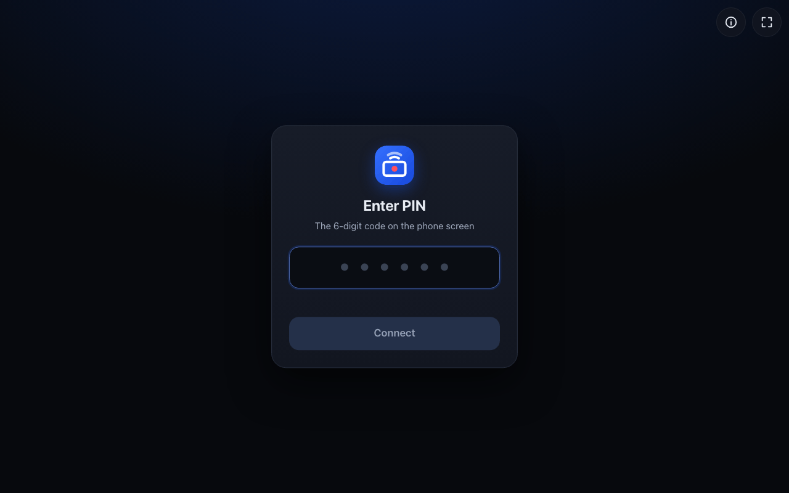
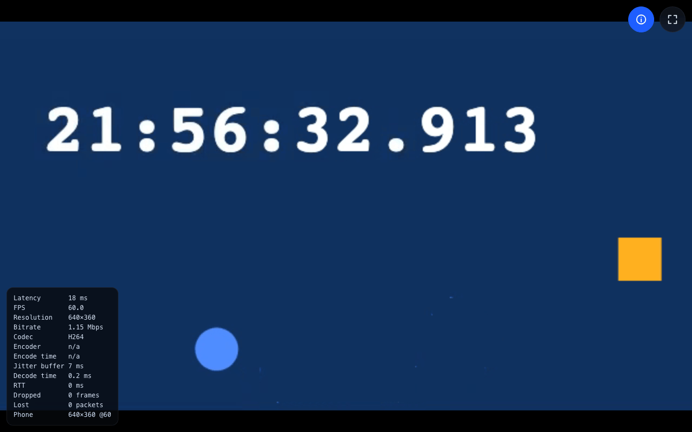
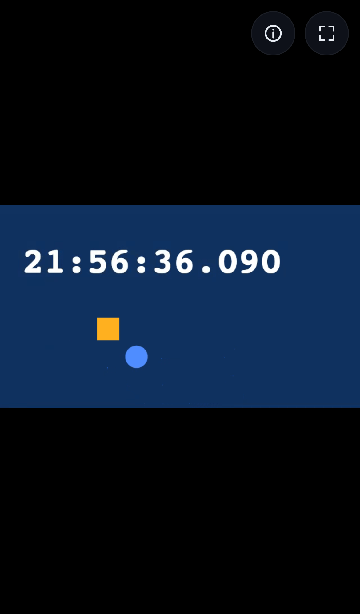

# LocalCast

Cast the screen of an Android phone or tablet to any device with a browser, over local Wi-Fi or the phone's hotspot. No internet and no cloud servers.

[](LICENSE)
[](https://github.com/limboSeeker/LocalCast/releases/latest)
[](https://github.com/limboSeeker/LocalCast/actions/workflows/android.yml)

<!-- Uncomment when docs/images/demo.gif is added
<p align="center"></p>
-->

<!-- Uncomment when docs/images/app-main.png and app-settings.png are added
<p align="center">
  
  
</p>
-->

<p align="center">
  
  
  
</p>

[Українська](README.uk.md)

- **Android 11+**: Samsung, Xiaomi, Google Pixel, OnePlus, MediaTek devices and others.
- **Viewing**: Chrome, Safari (iOS/macOS), Samsung Internet, Firefox, Edge. Nothing to install.
- **Capture**: MediaProjection. Frames go to the **hardware H.264 encoder** with no copies in memory. If there is no hardware H.264 encoder or it fails to start, software VP8 is used (up to 720p/30).
- **Transport**: WebRTC. The media stream is encrypted with DTLS-SRTP (AES-GCM).
- **Protection**: a 6-digit PIN. After 5 wrong attempts from one IP, that IP is locked out for 60 s.
- **Connecting**: by IP address or QR code (the PIN is filled in automatically).
- **Reconnecting**: automatic, after a Wi-Fi drop, a screen rotation, or when casting is stopped and started again.
- **Several viewers**: built for 1–4 at once (a laptop with a projector, phones, iPhone/iPad). The Wi-Fi bandwidth is split between them; when the device runs out of encoders, extra viewers get a lighter stream or a polite "device is busy" instead of an overloaded broadcast.
- **Pause**: viewers see a "Paused" card instead of your screen and stay connected. Casting pauses by itself when the screen turns off and resumes after unlock.
- **Broadcast health**: one card in the app tells whether everything is fine (network, heat, latency, device limit), with per-viewer details on tap.
- **Languages**: English and Ukrainian. The app follows the system language; on Android 13+ the app language can be changed in system settings (in the app: Settings → Мова / Language). The viewer page follows the browser language; `?lang=en` or `?lang=uk` in the address picks one explicitly.

## Download
The APK is on the [Releases](https://github.com/limboSeeker/LocalCast/releases/latest) page: `LocalCast-<version>-arm64.apk` for almost all phones and tablets, `-armv7.apk` only for old 32-bit devices. Allow "Install unknown apps" when asked. The APKs are signed with the developer's key; every release has their SHA-256 checksums in `SHA256SUMS.txt`.

> If you installed an earlier debug-signed build, uninstall it first — Android won't update an app signed with a different key.

## How to use
1. Put the phone and the viewing device on the same Wi-Fi network. Or turn on the hotspot on the phone and connect the other device to it.
2. In LocalCast, tap **Start** and allow screen recording (on Android 14+ choose "Entire screen" or a single app).
3. On the other device, open the address shown on the phone (`http://192.168.x.x:8080`) and enter the PIN. Or just scan the QR code with a camera. **Show to viewers** opens the QR code full screen at maximum brightness.
4. On the viewer page, the "i" button or the `S` key shows stats (FPS, bitrate, codec, encoder, latency). Double-tap or `F` toggles full screen. After 3 s without input the cursor and buttons hide: handy on a projector.
5. **Pause** hides your screen from viewers without disconnecting them; it is also in the notification.

**New PIN** disconnects all viewers. They can reconnect only with the new PIN.

## Settings
Presets: **Fast** (smoothness), **Balanced** (1080p, sharpness first; the default, good for text and documents), **Sharp**. Advanced settings:

| Setting | Options | Notes |
|---|---|---|
| Resolution | 720p / 1080p / Native | Short side of 720 or 1080 pixels, aspect ratio kept; never upscaled |
| Frame rate | Auto / 30 / 60 | Auto = 60 if the display runs at ≥60 Hz and the encoder supports it |
| Bitrate | Auto / 2–30 Mbps | Auto is derived from size and FPS (4–30 Mbps); with several viewers each gets a share of the Wi-Fi |
| Priority | Smoothness / Sharpness | Smoothness keeps the FPS and lowers the resolution a little if needed. Sharpness keeps the resolution |
| Require PIN | on / off | Without a PIN anyone on the network can connect |
| Pause when the screen is off | on / off | On by default: viewers don't see the lock screen or notifications. While LocalCast is open on air, the screen doesn't time out |

Changes apply immediately, without restarting the cast.

## Low latency and smoothness
- **Encoder.** A custom encoder factory (`org.webrtc.TunedVideoEncoderFactory`) on top of the hardware encoder: real-time priority, `KEY_LATENCY=1`, no B-frames, Qualcomm low-latency mode. If the encoder rejects these parameters, they are dropped one by one. Automatic resolution scaling by quality (the quality scaler) is off, so text doesn't blur.
- **Capture.** The VirtualDisplay renders straight at the target size (the GPU scales). FPS is capped on 90/120 Hz displays. Rotation and size changes don't restart capture.
- **Static screen.** The last frame is repeated about twice a second. A new viewer sees the picture at once, and it sharpens up shortly after.
- **Network.** Starts at a high bitrate right away. DSCP marking gives video priority on Wi-Fi (WMM). A low-latency Wi-Fi lock is held. The hotspot interface (ap0/swlan0) is not ignored.
- **Browser.** `jitterBufferTarget = 0`, hardware decoding in `<video>`. Stalled-stream check: if no frames arrive for more than 4 s, the connection is recreated.

## Building
Requires JDK 17+ and the Android SDK (platform 37.2, build-tools 36). Gradle downloads the wrapper itself.
```bash
./gradlew testDebugUnitTest lintDebug assembleDebug assembleRelease
```
The build produces one APK per architecture (no universal APK):

| Release APK (`app/build/outputs/apk/release/`) | For | Size |
|---|---|---|
| `app-arm64-v8a-release.apk` | modern phones and tablets | ~8.9 MB |
| `app-armeabi-v7a-release.apk` | older 32-bit devices | ~7.1 MB |
| `app-x86_64-release.apk` | x86_64 emulator | ~9.9 MB |

Release is built with R8. It is signed with the release key when one is configured (`keystore.properties` or `LOCALCAST_*` environment variables, see [docs/RELEASING.md](docs/RELEASING.md)), otherwise with the debug key for testing. Debug APKs (`app/build/outputs/apk/debug/app-<abi>-debug.apk`) are built without R8, ~45 MB.

Native libraries (`.so`) are stored compressed in the APK and extracted at install time. In 64-bit APKs their ELF segments are aligned to 16 KB (Android 15+).

UI strings: English in `app/src/main/res/values/` (default), Ukrainian in `values-uk/`. Lint fails the build if a string is missing in either language (`MissingTranslation`, `ExtraTranslation`). The viewer page keeps both languages in one dictionary in `app/src/main/assets/viewer/index.html`.

### CI
GitHub Actions (`.github/workflows/android.yml`) runs on push to `main`, on every pull request and on `v*` tags:
- `build`: `./gradlew testDebugUnitTest lintDebug assembleRelease`; artifacts are the arm64-v8a and armeabi-v7a release APKs and the lint report;
- `viewer-e2e`: viewer page tests from `tools/e2e` (mock server + Playwright Chromium);
- `release` (tags only): the APKs are signed with the release key from the repository secrets, renamed to `LocalCast-<version>-<abi>.apk` and published with `SHA256SUMS.txt` as a GitHub Release. See [docs/RELEASING.md](docs/RELEASING.md).

## Tests
- **Unit tests** (`./gradlew testDebugUnitTest`): PIN and lockout, protocol, signaling (Ktor test host), network address selection, size/FPS/bitrate calculation, viewer admission and Wi-Fi split, broadcast health.
- **Viewer page without a phone**: `tools/e2e` (mock server + Playwright), in Ukrainian and English browsers, on Chromium and WebKit (`npm run test:webkit`). See `tools/e2e/README.md`.
- **Live device or emulator** (`adb forward tcp:8080 tcp:8080`):
  - `node tools/e2e/device-check.mjs http://localhost:8080 <PIN> 10 [locale]`: stats and a screenshot;
  - `node tools/e2e/device-scenarios.mjs http://localhost:8080 <PIN>`: wrong PIN, reconnect, rotation, 4 viewers at once.

## Limitations
- **Signaling.** Signaling (PIN, SDP) goes over plain HTTP on the local network. The PIN protects against casual access, but not against an active man-in-the-middle on the same network. The media stream itself is encrypted.
- **Audio.** Not transmitted (it wasn't needed).
- **Control.** No remote control. The phone is operated only by hand.
- **Viewer screen.** A page served over `http://` can't use `wakeLock` (HTTPS only). The playing video keeps the display awake instead (checked in Chrome and Safari on macOS); other browsers and power settings may differ.
- **Latency.** Real latency depends on Wi-Fi: best is 5 GHz or the phone's own hotspot. Chrome shows measured latency when it provides the frame capture time. Otherwise the overlay shows an estimate summed from the parts of the pipeline.

## License
Apache License 2.0, see [LICENSE](LICENSE).
