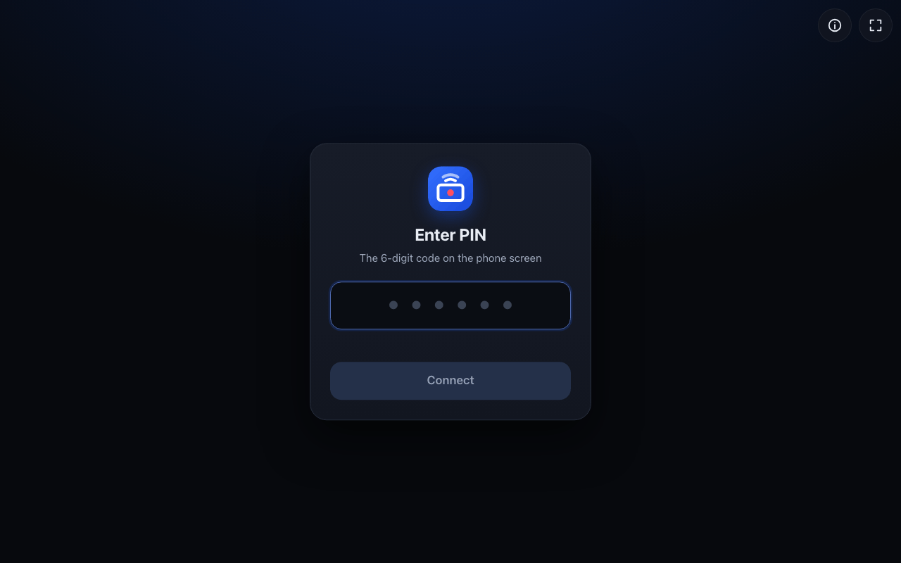
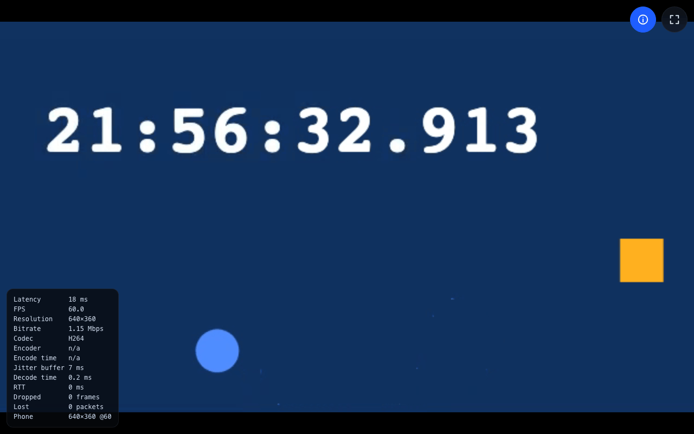
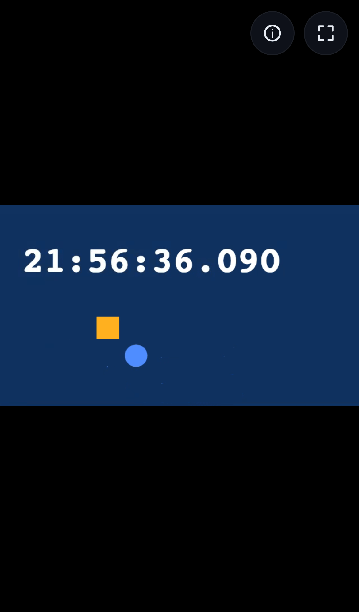

# LocalCast

Трансляція екрана Android-смартфона або планшета на будь-який пристрій із браузером у локальній мережі Wi-Fi або через точку доступу телефона. Без інтернету й без хмарних серверів.

[](LICENSE)
[](https://github.com/limboSeeker/LocalCast/releases/latest)
[](https://github.com/limboSeeker/LocalCast/actions/workflows/android.yml)

<!-- Розкоментувати, коли з'явиться docs/images/demo.gif
<p align="center"></p>
-->

<!-- Розкоментувати, коли з'являться docs/images/app-main.png і app-settings.png
<p align="center">
  
  
</p>
-->

<p align="center">
  
  
  
</p>

[English](README.md)

- **Android 11+**: Samsung, Xiaomi, Google Pixel, OnePlus, MediaTek-пристрої та інші.
- **Перегляд**: Chrome, Safari (iOS/macOS), Samsung Internet, Firefox, Edge. Нічого встановлювати не треба.
- **Захоплення**: MediaProjection. Кадри йдуть у **апаратний енкодер H.264** без копіювання в пам'ять. Якщо апаратного H.264 немає або він не запустився, використовується програмний VP8 (до 720p/30).
- **Передача**: WebRTC. Медіапотік зашифровано DTLS-SRTP (AES-GCM).
- **Захист**: PIN-код (6 цифр). Після 5 невірних спроб з однієї IP — блокування на 60 с.
- **Підключення**: за IP-адресою або QR-кодом (PIN підставляється автоматично).
- **Перепідключення**: автоматичне — після обриву Wi-Fi, повороту екрана, а також після зупинки й повторного запуску трансляції.
- **Кілька глядачів**: розраховано на 1–4 одночасно (ноутбук із проєктором, телефони, iPhone/iPad). Пропускна здатність Wi-Fi ділиться між ними; коли пристрою бракує енкодерів, зайві глядачі отримують полегшений потік або чемне «пристрій зайнятий», а трансляція не перевантажується.
- **Пауза**: глядачі бачать заставку «Пауза» замість вашого екрана й лишаються під'єднаними. Трансляція сама стає на паузу, коли екран вимикається, і продовжується після розблокування.
- **Стан трансляції**: одна картка в застосунку показує, чи все гаразд (мережа, нагрів, затримка, ліміт пристрою), а на дотик — подробиці по кожному глядачу.
- **Мови**: англійська й українська. Застосунок бере мову системи; на Android 13+ мову застосунку можна змінити в налаштуваннях системи (у застосунку: Налаштування → Мова / Language). Сторінка перегляду бере мову браузера; `?lang=uk` або `?lang=en` в адресі задає її явно.

## Завантаження
APK — на сторінці [Releases](https://github.com/limboSeeker/LocalCast/releases/latest): `LocalCast-<версія>-arm64.apk` для майже всіх телефонів і планшетів, `-armv7.apk` лише для старих 32-бітних пристроїв. Коли система спитає, дозвольте «Встановлення невідомих застосунків». APK підписані ключем розробника; контрольні суми SHA-256 лежать у `SHA256SUMS.txt` у кожному релізі.

> Якщо у вас встановлена попередня збірка, підписана debug-ключем, спершу видаліть її — Android не оновлює застосунок, підписаний іншим ключем.

## Як користуватися
1. Телефон і пристрій для перегляду мають бути в одній мережі Wi-Fi. Інший варіант: увімкнути точку доступу на телефоні й під'єднати до неї другий пристрій.
2. У LocalCast натисніть **«Почати»** → дозвольте запис екрана (на Android 14+ оберіть «Весь екран» або одну програму).
3. На іншому пристрої відкрийте адресу з екрана (`http://192.168.x.x:8080`) і введіть PIN. Або просто відскануйте QR-код камерою. **«Показати глядачам»** відкриває QR-код на весь екран з максимальною яскравістю.
4. На сторінці перегляду: кнопка «i» або клавіша `S` показує статистику (FPS, бітрейт, кодек, енкодер, затримку). Подвійний дотик або `F` вмикає повний екран. Через 3 с без дій курсор і кнопки ховаються — зручно на проєкторі.
5. **«Пауза»** ховає ваш екран від глядачів, не від'єднуючи їх; вона є і в сповіщенні.

**«Новий PIN»** від'єднує всіх глядачів. Підключитися знову можна лише з новим PIN.

## Налаштування
Пресети: **Швидко** (плавність), **Баланс** (1080p, пріоритет чіткості; за замовчуванням, добре для тексту й документів), **Чітко**. Розширені налаштування:

| Параметр | Варіанти | Примітка |
|---|---|---|
| Роздільна здатність | 720p / 1080p / Нативна | Коротка сторона 720 або 1080 пікселів зі збереженням пропорцій; без збільшення |
| Частота кадрів | Авто / 30 / 60 | «Авто» = 60, якщо екран ≥60 Гц і енкодер це підтримує |
| Бітрейт | Авто / 2–30 Мбіт/с | «Авто» розраховується з розміру й FPS (4–30 Мбіт/с); кільком глядачам дістається частка Wi-Fi |
| Пріоритет | Плавність / Чіткість | Плавність тримає FPS, а за потреби трохи зменшує роздільність. Чіткість тримає роздільність |
| Вимагати PIN | так / ні | Без PIN підключитися може будь-хто в мережі |
| Пауза, коли екран вимкнено | так / ні | За замовчуванням увімкнено: глядачі не бачать екрана блокування й сповіщень. Поки LocalCast відкритий в ефірі, екран не гасне |

Зміни застосовуються одразу, без перезапуску трансляції.

## Що зроблено для низької затримки й плавності
- **Енкодер.** Власна фабрика енкодера (`org.webrtc.TunedVideoEncoderFactory`) поверх апаратного енкодера: пріоритет реального часу, `KEY_LATENCY=1`, без B-кадрів, режим низької затримки Qualcomm. Якщо енкодер не приймає ці параметри, вони вимикаються по одному. Автоматичне зниження роздільності за якістю (quality scaler) вимкнене, тож текст не «пливе».
- **Захоплення.** VirtualDisplay одразу в цільовому розмірі (масштабує GPU). FPS обмежується на екранах 90/120 Гц. Поворот і зміна розміру не перезапускають захоплення.
- **Статичний екран.** Останній кадр повторюється приблизно 2 рази на секунду. Новий глядач одразу бачить картинку, а зображення дотягується до чіткого.
- **Мережа.** Старт одразу з високим бітрейтом. Позначки DSCP дають пріоритет відео в Wi-Fi (WMM). Блокування Wi-Fi у режимі низької затримки. Інтерфейс точки доступу (ap0/swlan0) не ігнорується.
- **Браузер.** `jitterBufferTarget = 0`, апаратне декодування в `<video>`. Перевірка «завислого» потоку: якщо кадрів немає понад 4 с, з'єднання пересоздається.

## Збирання
Потрібні JDK 17+ і Android SDK (platform 37.2, build-tools 36). Gradle завантажить wrapper сам.
```bash
./gradlew testDebugUnitTest lintDebug assembleDebug assembleRelease
```
Результат — окремий APK на кожну архітектуру (універсальний APK не збирається):

| Release APK (`app/build/outputs/apk/release/`) | Для чого | Розмір |
|---|---|---|
| `app-arm64-v8a-release.apk` | сучасні телефони й планшети | ~8,9 МБ |
| `app-armeabi-v7a-release.apk` | старі 32-бітні пристрої | ~7,1 МБ |
| `app-x86_64-release.apk` | емулятор x86_64 | ~9,9 МБ |

Release збирається з R8. Він підписується release-ключем, якщо той налаштований (`keystore.properties` або змінні середовища `LOCALCAST_*`, див. [docs/RELEASING.md](docs/RELEASING.md)), інакше — debug-ключем для перевірки. Debug APK (`app/build/outputs/apk/debug/app-<abi>-debug.apk`) — без R8, ~45 МБ.

Нативні бібліотеки (`.so`) лежать в APK стиснутими й розпаковуються під час встановлення. У 64-бітних APK їхні ELF-сегменти вирівняні на 16 KB (Android 15+).

Тексти інтерфейсу: англійські в `app/src/main/res/values/` (за замовчуванням), українські — у `values-uk/`. Lint зупиняє збирання, якщо рядка бракує в одній із мов (`MissingTranslation`, `ExtraTranslation`). Сторінка перегляду тримає обидві мови в одному словнику в `app/src/main/assets/viewer/index.html`.

### CI
GitHub Actions (`.github/workflows/android.yml`) на push у `main`, на кожен pull request і на теги `v*`:
- `build`: `./gradlew testDebugUnitTest lintDebug assembleRelease`; артефакти — release APK arm64-v8a і armeabi-v7a та звіт lint;
- `viewer-e2e`: тести сторінки перегляду з `tools/e2e` (мок-сервер + Playwright Chromium);
- `release` (лише теги): APK підписуються release-ключем із секретів репозиторію, перейменовуються в `LocalCast-<версія>-<abi>.apk` і публікуються разом із `SHA256SUMS.txt` як GitHub Release. Див. [docs/RELEASING.md](docs/RELEASING.md).

## Тести
- **Юніт-тести** (`./gradlew testDebugUnitTest`): PIN і блокування, протокол, сигналізація (Ktor test host), вибір мережевих адрес, розрахунок розміру/FPS/бітрейту, допуск глядачів і поділ Wi-Fi, стан трансляції.
- **Сторінка перегляду без телефона**: `tools/e2e` (мок-сервер + Playwright), в українському й англійському браузері, на Chromium і WebKit (`npm run test:webkit`). Див. `tools/e2e/README.md`.
- **Живий пристрій або емулятор** (`adb forward tcp:8080 tcp:8080`):
  - `node tools/e2e/device-check.mjs http://localhost:8080 <PIN> 10 [locale]` — статистика й скриншот;
  - `node tools/e2e/device-scenarios.mjs http://localhost:8080 <PIN>` — невірний PIN, перепідключення, поворот, 4 глядачі одночасно.

## Обмеження
- **Сигналізація.** Сигналізація (PIN, SDP) іде по HTTP у локальній мережі. PIN захищає від випадкового доступу, але не від активної атаки «людина посередині» в тій самій мережі. Сам медіапотік зашифровано.
- **Звук.** Не передається (не був потрібен).
- **Керування.** Віддаленого керування немає. Телефоном керують лише фізично.
- **Екран глядача.** Сторінка на `http://` не може використати `wakeLock` (лише HTTPS). Натомість екран не дає згаснути саме відео, що грає (перевірено в Chrome і Safari на macOS); інші браузери й налаштування живлення можуть поводитися інакше.
- **Затримка.** Реальна затримка залежить від Wi-Fi: найкраще — 5 ГГц або точка доступу самого телефона. Chrome показує виміряну затримку, якщо дає час захоплення кадру. Інакше в оверлеї показується оцінка зі складових.

## Ліцензія
Apache License 2.0, див. [LICENSE](LICENSE).
